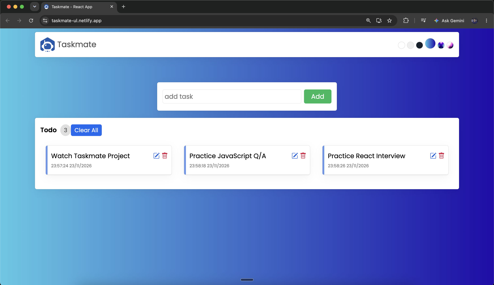

# Taskmate

Taskmate is a React to-do app. You can add, edit, and delete tasks, clear the whole list, and choose from six themes. Your tasks and selected theme are saved in your browser.

[Try the live demo](https://taskmate-ul.netlify.app/)



## Run locally

Taskmate uses React and React DOM **19.3.1**. Use Node.js **26.13.1** for the course setup. Installation and builds also passed on Node.js 22.22.2 and 24.15.0.

From the project folder, run the following commands:

```sh
npm ci
npm start
```

Open [localhost:3000](http://localhost:3000) to use the app. Run `npm run build` to create a production build in `build/`.
